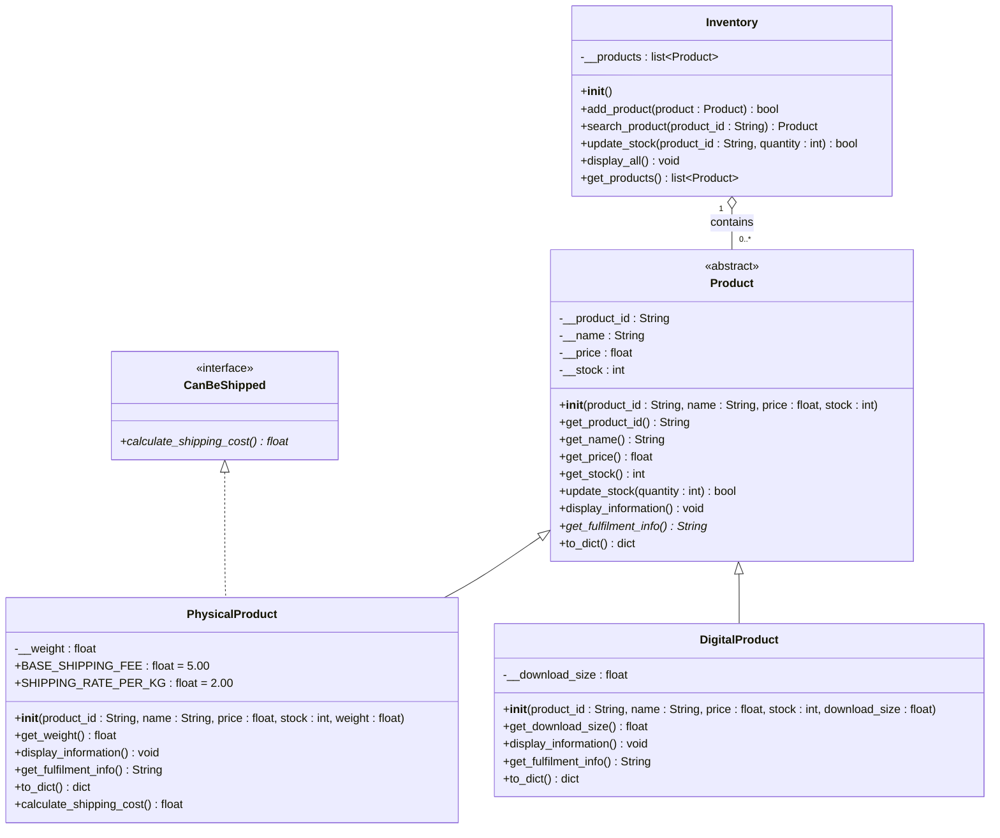

# Week 9 Lab 7 – UML Class Diagram

`-` = private, `+` = public, *italic* / `*` = abstract method

## Relationships

| Line | Meaning |
|---|---|
| `PhysicalProduct` → `Product`, solid line, hollow triangle | Inheritance: a PhysicalProduct **is a** Product |
| `DigitalProduct` → `Product`, solid line, hollow triangle | Inheritance: a DigitalProduct **is a** Product |
| `PhysicalProduct` → `CanBeShipped`, dashed line, hollow triangle | Interface realisation: a PhysicalProduct **can be** shipped |
| `Inventory` ◇— `Product`, 1 to 0..* | Aggregation: an Inventory holds any number of Products |

## Notes

- `Product` is `<<abstract>>`: it cannot be created directly, and every subclass must implement the abstract method `get_fulfilment_info()`.
- `CanBeShipped` is an `<<interface>>` (an abstract base class with only an abstract method and no attributes). Only `PhysicalProduct` implements it; `DigitalProduct` does not.
- `display_information()`, `get_fulfilment_info()` and `to_dict()` appear again in the subclasses because they **override** the parent versions.
- `Inventory` only depends on `Product`, so it works with any subclass without changes.
- File handling (`file_handler.py`) and the menu (`week8lab_oop_auditor.py`) are plain functions, not classes. `create_product()` in `file_handler.py` reads the saved `"type"` and creates the matching subclass.
