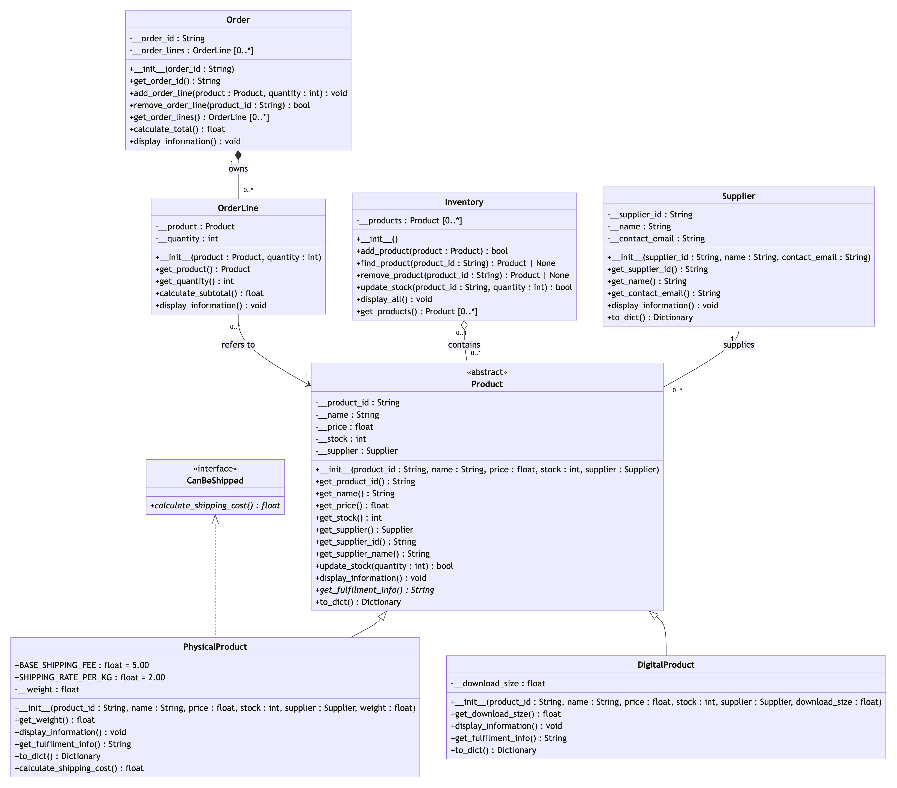
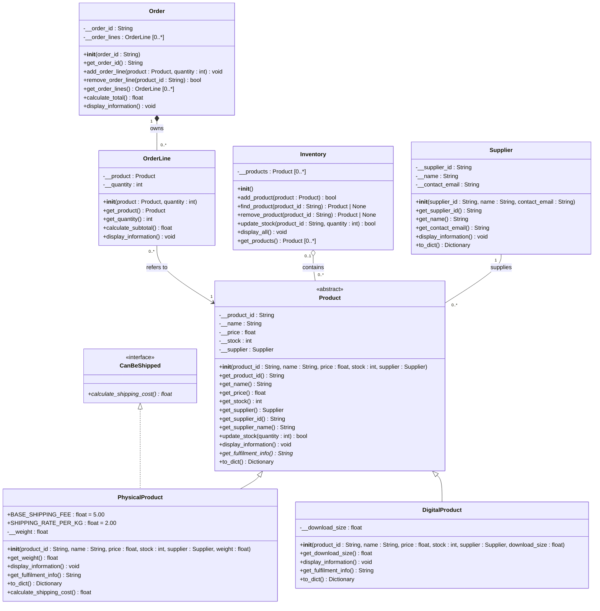

# Week 10 Lab 8 – UML Class Diagram

`-` = private, `+` = public, `*` = abstract method. Types are language-independent: `String`, `float`, `int`, `bool`, `void`; a collection is written as `Type [0..*]`.

Mermaid source (renders on GitHub):

## Relationships

| Relationship | Notation | Multiplicity | Why |
|---|---|---|---|
| `PhysicalProduct`, `DigitalProduct` → `Product` | Inheritance: solid line, hollow triangle at Product | – | Each **is a** Product |
| `PhysicalProduct` → `CanBeShipped` | Realisation: dashed line, hollow triangle at CanBeShipped | – | A PhysicalProduct **can be** shipped |
| `Supplier` — `Product` | **Association**: plain solid line | Supplier 1 — 0..* Product | Each product has one supplier; a supplier supplies any number. Neither owns the other, and both exist independently |
| `Inventory` ◇— `Product` | **Aggregation**: hollow diamond at Inventory | Inventory 0..1 ◇— 0..* Product | An Inventory is made of Products, but a Product can exist outside any Inventory and be moved between them |
| `Order` ◆— `OrderLine` | **Composition**: filled diamond at Order | Order 1 ◆— 0..* OrderLine | The Order creates its OrderLines; each line belongs to exactly one Order and never moves |
| `OrderLine` → `Product` | **Association**: solid line | OrderLine 0..* — 1 Product | A line refers to one Product but does not own it; the Product may also be in an Inventory |

## Notes

- `Product` is `<<abstract>>` and cannot be created directly. `get_fulfilment_info()` is abstract and implemented by both subclasses.
- `__supplier : Supplier` is a stored reference, but it is an **association**, not aggregation or composition: a Product is not a whole made of a Supplier.
- `Inventory` and `Order` type their collections by `Product` and `OrderLine`, so any Product subclass works without changes.
- `Product | None` means the method returns a Product, or nothing if no match is found.
- File handling (`file_handler.py`) and the menu (`oop_auditor.py`) are plain functions, not classes.
