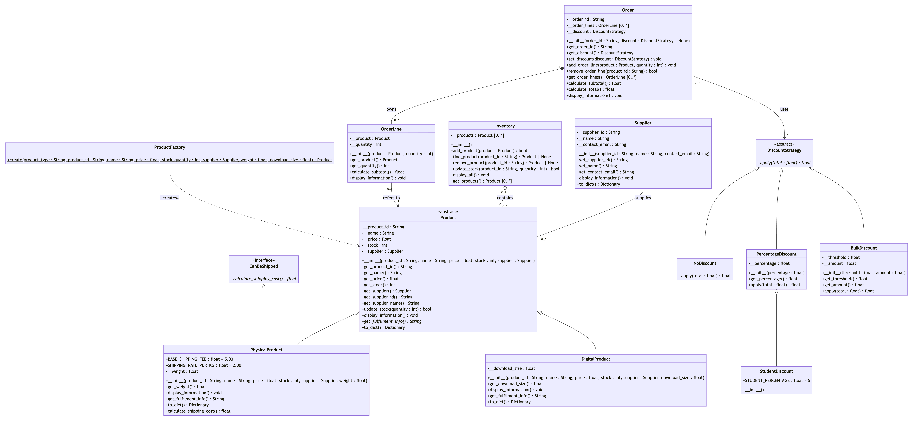
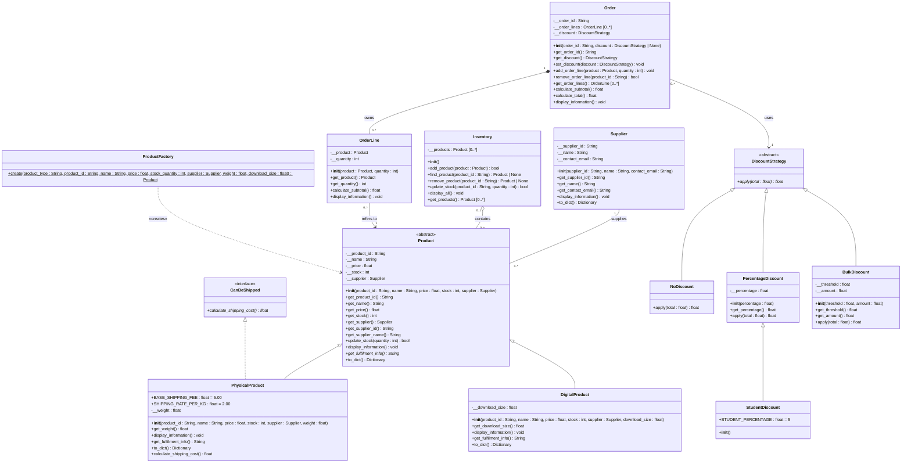

# Week 11 Lab 9 – UML Class Diagram

`-` = private, `+` = public, `*` = abstract method, underlined / `$` = static method. Types are language-independent: `String`, `float`, `int`, `bool`, `void`; a collection is written as `Type [0..*]`.

Mermaid source (renders on GitHub):

## New in Lab 9

| Relationship | Notation | Multiplicity | Why |
|---|---|---|---|
| `NoDiscount`, `PercentageDiscount`, `BulkDiscount` → `DiscountStrategy` | Inheritance: solid line, hollow triangle at DiscountStrategy | – | Each **is a** DiscountStrategy and implements `apply()` |
| `StudentDiscount` → `PercentageDiscount` | Inheritance | – | A StudentDiscount **is a** 5% PercentageDiscount |
| `Order` → `DiscountStrategy` | **Association**: solid line with an arrow | Order 0..* — 1 DiscountStrategy | An Order **uses** exactly one strategy at a time to calculate its total. The strategy is not part of the Order, is created outside it, can be swapped with `set_discount()`, and one strategy object can be shared by many Orders |
| `ProductFactory` → `Product` | **Dependency**: dashed arrow labelled «creates» | – | The factory creates Products but does not store them |

## Relationships kept from Lab 8

| Relationship | Notation | Multiplicity |
|---|---|---|
| `PhysicalProduct`, `DigitalProduct` → `Product` | Inheritance | – |
| `PhysicalProduct` → `CanBeShipped` | Realisation: dashed line, hollow triangle | – |
| `Supplier` — `Product` | Association | Supplier 1 — 0..* Product |
| `Inventory` ◇— `Product` | Aggregation | Inventory 0..1 ◇— 0..* Product |
| `Order` ◆— `OrderLine` | Composition | Order 1 ◆— 0..* OrderLine |
| `OrderLine` → `Product` | Association | OrderLine 0..* — 1 Product |

## Notes

- `DiscountStrategy` is `<<abstract>>`: it only declares `apply()`. `Order` depends on this abstraction and never on a specific discount class, so a new discount is a new class with no change to `Order`.
- `ProductFactory.create()` is a static method that returns the abstract type `Product`. Only the factory knows the concrete classes `PhysicalProduct` and `DigitalProduct`.
- `__init__(order_id, discount : DiscountStrategy | None)`: when no strategy is given, the Order uses a `NoDiscount`, so it always holds exactly one strategy.
- File handling (`file_handler.py`, including `load_products()`), input helpers (`input_helpers.py`) and the menu (`oop_auditor.py`) are plain functions, not classes.
