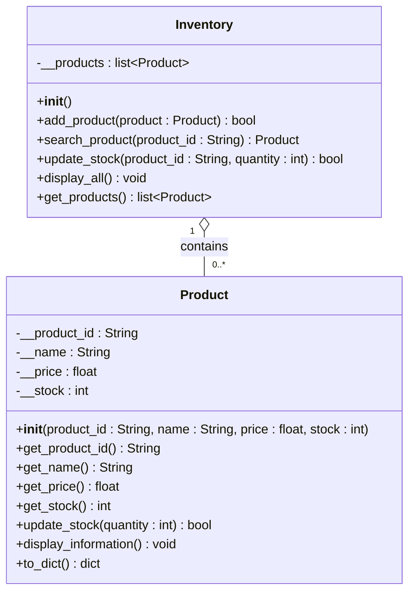

# Week 8 Lab 6 – UML Class Diagram

`-` = private, `+` = public



Plain-text version:

```
+----------------------------------------------+
|                   Product                    |
+----------------------------------------------+
| - __product_id : String                      |
| - __name : String                            |
| - __price : float                            |
| - __stock : int                              |
+----------------------------------------------+
| + get_product_id() : String                  |
| + get_name() : String                        |
| + get_price() : float                        |
| + get_stock() : int                          |
| + update_stock(quantity : int) : bool        |
| + display_information() : void               |
| + to_dict() : dict                           |
+----------------------------------------------+
                      ^ 0..*
                      |
                      ◇ 1
+----------------------------------------------+
|                  Inventory                   |
+----------------------------------------------+
| - __products : list[Product]                 |
+----------------------------------------------+
| + add_product(product : Product) : bool      |
| + search_product(product_id : String)        |
|       : Product                              |
| + update_stock(product_id : String,          |
|       quantity : int) : bool                 |
| + display_all() : void                       |
| + get_products() : list[Product]             |
+----------------------------------------------+
```

File handling (`file_handler.py`) and the menu (`week8lab_oop_auditor.py`) are plain functions, not classes, as allowed by the lab sheet. `load_inventory()` creates Product objects from `inventory.json` and adds them to an Inventory; `save_inventory()` reads them back out with `get_products()` and `to_dict()`.
